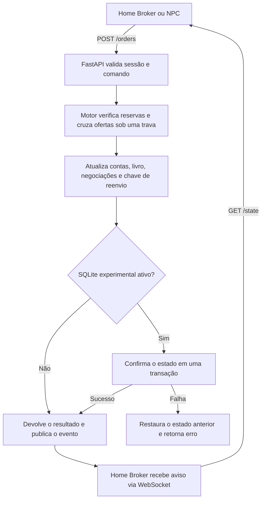

# Regras do mercado

## Objetivo

Simular um mercado de ativos virtuais com vários investidores.
O servidor recebe e valida ordens, controla as contas e fornece o estado consultado pelos clientes.

## Investidores e ativos

Cada investidor começa com R$ 1.000,00 de capital virtual e nenhuma ação na carteira.

Os ativos disponíveis são PETR4, VALE3 e ITUB4.
Esses códigos são usados na simulação; as cotações não representam dados reais da bolsa.

## Ordens

Cada ordem informa:

- Ativo negociado.
- Operação: compra (BUY) ou venda (SELL).
- Quantidade de ações.
- Preço por ação.

A quantidade deve ser inteira, entre 1 e 1.000.000.
O preço deve ser positivo, com até duas casas decimais e dez dígitos inteiros.

O investidor pode operar somente os ativos cadastrados.
O servidor identifica a conta pela sessão recebida.

## Validação das operações

Uma compra exige saldo suficiente para pagar o valor total:

valor total = quantidade × preço por ação

Uma venda exige que o investidor possua a quantidade solicitada do ativo.

Não são permitidos empréstimos, saldo negativo ou venda de ações que o investidor não possui.

Ordens recusadas não alteram saldo, carteira ou histórico de ordens executadas.

## Execução na Parte 1

As ordens válidas são executadas imediatamente ao preço informado, contra uma contraparte simulada.

Não é necessário existir uma ordem de outro investidor para executar uma compra ou venda nesta etapa.

Na compra, o valor total é descontado do saldo e as ações são adicionadas à carteira. Na venda, ocorre o inverso.

Não são cobradas taxas. Todas as operações usam reais virtuais.

## Formação de preços e patrimônio

As cotações são simuladas pelo servidor a cada três segundos. Cada atualização aplica uma variação aleatória entre -R$ 0,25 e R$ 0,25, respeitando o preço mínimo de R$ 1,00.

Nesta etapa, as ordens não alteram as cotações.
O preço informado na ordem determina sua execução simulada.

A variação percentual é calculada em relação ao preço inicial do ativo na execução atual do servidor.

O patrimônio corresponde ao saldo disponível somado ao valor das ações pelas cotações atuais:

patrimônio = saldo + soma de (quantidade de cada ativo × sua cotação atual)

## Concorrência e ordenação atuais

A validação e a atualização de cada operação ocorrem sob uma trava no processo do backend.

As operações são processadas uma por vez nessa região, evitando o uso simultâneo indevido de saldo ou ações.

A ordem de aquisição da trava não garante prioridade pela chegada das requisições. A Parte 1 ainda não possui uma política de prioridade de preço e tempo.

## Modo experimental da Parte 2

No backend, ative `BOLSA_MATCHING=1` antes de iniciar o Uvicorn. No
PowerShell, use `$env:BOLSA_MATCHING = "1"`. Execute um único processo.
Sem essa variável, permanece disponível o protótipo de execução imediata.

- Cada conta de teste recebe R$ 1.000,00 e 10 ações de cada ativo.
- Ofertas limitadas aguardam no livro por ativo. O melhor preço tem prioridade,
  com desempate pela ordem de registro no servidor.
- O preço executado é o da oferta que já estava no livro. A última negociação
  determina a cotação e atualiza seu histórico.
- O saldo comprometido pelo preço limite e as ações ofertadas são reservados
  pela quantidade em aberto. A execução parcial mantém o restante no livro.
- Se o preço da nova ordem cruzar uma oferta da própria conta, a ordem é
  rejeitada antes de qualquer execução.
- Apenas o dono pode cancelar o restante de uma ordem aberta. O cancelamento
  libera a reserva e preserva as negociações já realizadas.
- O preço médio é ponderado pelo custo das ações ainda na carteira. As 10
  ações iniciais de cada ativo usam o preço de abertura como custo. O lucro
  ou prejuízo não realizado compara o valor atual da posição com esse custo.
  O volume soma as ações executadas no mercado, contando cada negócio uma vez.

Por padrão, as sessões e os dados desse modo ficam em memória. Para testar
a recuperação após reinício, configure `BOLSA_MARKET_DB` com o caminho de
um SQLite separado. Nesse modo cada alteração confirmada grava o estado
inteiro em uma transação, incluindo saldos, posições, livro, negociações,
sessões de demonstração e chaves de idempotência. Reservas são recalculadas
a partir das quantidades em aberto. Se a gravação falhar, o estado em memória
é restaurado e a API não emite evento de sucesso.

Use apenas um processo por banco e um diretório gravável. O checkpoint
contém dados e tokens do ambiente de demonstração. Ele serve para provar
a recuperação local. A integração com JWT e o esquema definitivo ficam
para a etapa seguinte.

### NPC de liquidez

Com o backend no modo experimental, execute `python bot.py` na pasta
`backend`. O agente usa a mesma API dos investidores. A cada ciclo, tenta
manter uma oferta de compra e uma de venda por ativo, em torno da última
cotação, com um afastamento de R$ 0,10 de cada lado. Cancela ofertas abertas
cujo preço ficou desatualizado. Cada nova oferta tem de uma a três ações,
limitadas pelo saldo ou pela posição disponível.

Use `--once` para um ciclo, `--seed` para definir a sequência de quantidades,
`--interval` para configurar a pausa em segundos e `--url` para outro backend.
O agente usa a conta de demonstração `NPC Liquidez` por padrão. Use
`--username` para escolher outra conta e mantenha uma instância por nome.

### Fluxo de uma ordem

### Teste de recuperação

Com o SQLite experimental ativo, duas sessões negociaram 2 PETR4. A
compra de 2 a R$ 40,00 chegou primeiro, e a venda de 4 a R$ 39,00
executou parcialmente a R$ 40,00. Antes e depois de reiniciar o backend,
o vendedor tinha R$ 1.080,00 e 8 PETR4, o comprador tinha R$ 920,00 e
12 PETR4, e o livro mantinha 2 ações à venda a R$ 39,00. As duas
sessões recuperaram o mesmo histórico e responderam por WebSocket.
Em um teste separado, reenviar uma ordem aceita com a mesma chave após
reiniciar retornou o mesmo ID, sem uma segunda negociação.

No Docker Compose, uma cópia limpa subiu com `compose.persist.yaml` e um
volume vazio. A venda chegou primeiro, então 2 PETR4 foram negociadas a
R$ 39,00. O contêiner do backend foi substituído e o Home Broker
permaneceu ativo. As duas sessões retornaram os mesmos snapshots pelo
proxy, o WebSocket voltou a responder, e o reenvio recuperou a ordem
original sem criar outro negócio.

O teste de concorrência inicia a segunda requisição pela API enquanto a
primeira ainda está gravando no SQLite. Se a compra de 2 ações chega ao
motor primeiro, ela executa uma vez e o cancelamento libera apenas as
2 ações restantes da venda de 4. Na ordem inversa, o cancelamento libera
as 4 ações e a compra fica aberta, com R$ 80,00 reservados. O teste reabre
o mesmo banco e verifica carteiras, saldos, reservas, livro, histórico
e reenvio com a mesma chave nos dois casos.

### Carga com e sem SQLite

Medição local em 27/11/2026, com um processo FastAPI, cliente HTTP em
processo separado e três rodadas por cenário. Os mesmos cenários foram
executados primeiro em memória e depois com um arquivo SQLite temporário
vazio. O NPC ficou desativado. Os cenários de cada modo compartilharam a
mesma instância, portanto os históricos cresceram ao longo da execução.
O p95 é medido no cliente e inclui os reenvios. A vazão da tabela conta
somente ordens novas.

| Clientes | Memória p95 | SQLite p95 | Memória ordens/s | SQLite ordens/s |
| ---: | ---: | ---: | ---: | ---: |
| 5 | 51 ms | 62 ms | 69,36 | 58,70 |
| 20 | 243 ms | 282 ms | 70,14 | 61,29 |
| 50 | 1.189 ms | 969 ms | 37,44 | 50,20 |
| 100 | 1.597 ms | 2.740 ms | 54,52 | 33,35 |

Cada modo registrou 525 ordens novas, 24 reenvios reconhecidos e 261
negociações. Todos os cenários passaram nas verificações de saldo, ações,
reservas, livro e unicidade de ordens. A 100 clientes, o SQLite teve p95
cerca de 72% maior e vazão cerca de 39% menor. A inversão a 50 clientes
mostra a variabilidade desta execução local. Esses números descrevem
uma execução por modo, sem medição de CPU ou memória.

Para repetir, rode `python backend/load_test.py --url http://127.0.0.1:8000`
contra duas instâncias descartáveis, uma com e outra sem
`BOLSA_MARKET_DB`. Mantenha os mesmos parâmetros e desative o NPC.

### Repetição com ordem alternada

Em 27/11/2026, a sequência memória → SQLite foi seguida por
SQLite → memória, com um processo novo para cada modo e três rodadas por
cenário. Um ensaio inicial foi interrompido a 100 clientes. As duas
sequências completas usaram uma cópia temporária do cliente de carga com
45 segundos de timeout HTTP em ambos os modos. Os 16 cenários completos
passaram nas verificações de integridade. A CPU média é expressa em
percentual de um núcleo lógico. O pico de memória residente foi amostrado
a cada 250 ms no backend e seus processos filhos.

| Clientes | Modo | p95 nas duas execuções | Ordens/s nas duas execuções | CPU média | Pico residente |
| ---: | --- | ---: | ---: | ---: | ---: |
| 5 | Memória | 62–163 ms | 20,44–52,17 | 5,2–5,6% | 73,5–93,5 MiB |
| 5 | SQLite | 88–109 ms | 34,14–40,42 | 14,0–14,1% | 93,5–93,8 MiB |
| 20 | Memória | 879–960 ms | 18,34–20,18 | 7,8–12,1% | 70,9–95,7 MiB |
| 20 | SQLite | 580–796 ms | 22,22–31,42 | 16,8–22,3% | 96,8–97,1 MiB |
| 50 | Memória | 2,20–4,93 s | 11,50–24,99 | 10,2–15,9% | 57,0–99,4 MiB |
| 50 | SQLite | 2,06–2,41 s | 22,48–25,26 | 28,5–32,8% | 102,2–102,7 MiB |
| 100 | Memória | 3,43–7,07 s | 14,42–29,08 | 11,8–13,0% | 50,9–90,8 MiB |
| 100 | SQLite | 3,70–4,58 s | 22,65–24,98 | 37,7–39,9% | 104,4–114,7 MiB |

A 100 clientes, o p95 em segundos foi 7,07 → 4,58 na sequência
memória → SQLite e 3,70 → 3,43 na sequência inversa. A direção da
diferença de latência variou, enquanto o SQLite consumiu mais CPU em
todos os pares medidos. O teste verifica a recuperação e o comportamento
sob carga local. Uma decisão de otimização exige novas repetições e
medição em ambiente controlado.

## Limitações do protótipo

As sessões atuais são identificadas por nome, sem comprovação de identidade. Os dados permanecem em memória e são perdidos quando o backend reinicia.

A proteção de concorrência atende a um único processo servidor.
A execução com múltiplos processos exigirá coordenação adicional.

As instruções de execução, o contrato REST e o roteiro de testes estão em [PROTOTIPO_ORDENS.md](PROTOTIPO_ORDENS.md).
